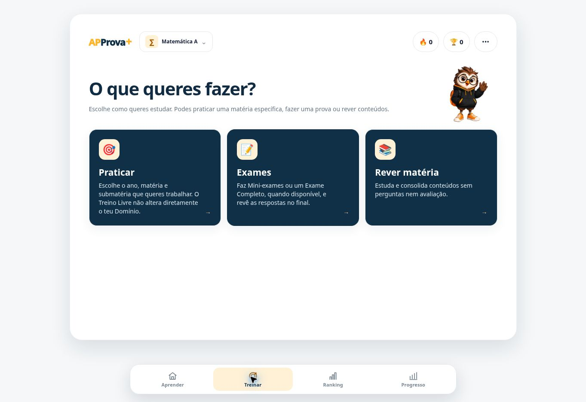
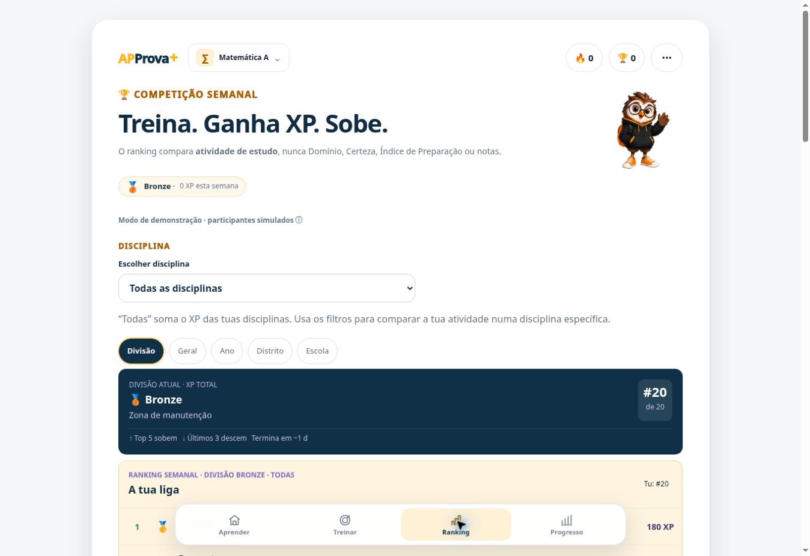

# Publicação conjunta #414/#415 — 25 de outubro de 2026

**Estado: publicada e verificada.** A autorização do utilizador foi «Avança para isso», após a preparação das duas PRs.

## A. Alterações
- #414: Treinar com a formatação de Aprender, descrição cinzenta sem cartão, Apronso à direita e linha do Olá reservada sem o mostrar.
- #415: Ranking com Apronso à direita e divisão/XP numa etiqueta compacta sob a descrição, para PC e mobile, nas três disciplinas.
- Mantidos valores globais e do filtro por disciplina, aviso de participantes simulados e restantes regras pedagógicas.

SHA publicado: `715e8adbeaae5fd4c06ed0e70727401ceab9f36d`.
Árvore: `0ca1f8b1629f1b86cba39e799b4544f93a45fd6d`.
As diferenças relativamente à anterior publicação74b não incluem app/lib, app/api, db ou vercel.json.

## B. Validação
[Beta CI do SHA integrado — 40242554557](https://github.com/carlosdanielriosazevedo/aplus-exames/actions/runs/40242554557), job121317281902: SUCCESS.
- 150 testes browser, 836 unitários e 770 verificações de compatibilidade sintética: PASS.
- Technical Gate: GO; auditorias e Grader Quality executados; build integral: PASS.
- Bundle total por rota: /350,7 de650 KiB; Português mini-exame449,5 de500 KiB. Limites inalterados.
- CI da #414:40193372105; CI da #415:40241889385, ambos SUCCESS.
- Chromium no CI: três disciplinas, mobile320/360/390/430 e desktop1366/1920. Não foi executado teste em telemóvel físico.

O Chromium local não arrancou devido às restrições do runtime. Para o artefacto real utilizou-se o browser disponibilizado no Work, sem contornar essas restrições.

## C. Artefacto faseado
Deployment `dpl_85RxTaGJJAkmTMn1jheC1u2roGhY`, READY, production, fra1.
Projeto real: `prj_H0nD83gkRwu7Id05OhzL4CC60s4M`, equipa `team_8tJYQLhNITkMzSpmKjThB9H5`.
URL imutável: https://aplus-exames-c9rtqoxcv-carlos-rios-azevedo-s-projects.vercel.app

Um único build funcional deliberado, com gitSource.ref/sha fixos no SHA integrado, usando a configuração production existente no servidor. Não foram lidos/copied secrets nem modificadas variáveis.

Antes da promoção, www e raiz continuavam no deployment anterior `dpl_3vf3eAhMfrV9i7nH3qMxhe9du9hi`.
Health autenticado200: backend configurado/acessível, schema8/migração008, fra1; APIs de smoke/preview ausentes.

No browser do artefacto faseado:
- Onboarding local sintético nas três disciplinas: secundário concluído, nota14 e objetivo17.
- Treinar e Ranking abertos nas três disciplinas; filtro Português manteve divisão/XP total globais.
- Reload conservou a disciplina Física e Química A; Progresso abriu.
- Sem conta criada, respostas submetidas ou gravacões de ensaio na base. Não se afirma medição de zero tentativas de escrita de rede neste browser, nem novo teste de autenticação/cloud.

## D. Publicação
GO registado na [Issue#373, comentário6404731256](https://github.com/carlosdanielriosazevedo/aplus-exames/issues/373#issuecomment-6404731256).
Executada uma promoção do mesmo deployment85Rx, sem rebuild.
Aliases raiz, www, aplus-exames.vercel.app e git-main confirmados no mesmo ID.

Após a promoção:
- GET raiz:200.
- GET www:200, redireciona para https://approvamais.pt/.
- GET público /api/health:200, backendReachable=true, schemaVersion8, fra1.
- No domínio público, percurso anónimo sintético local de Matemática A e abertura de Treinar/Ranking confirmados visualmente.
- Capturas abaixo mostram a versão pública com perfil sintético de0 XP; não são dados de alunos.

## E. Segurança e recuperação
Sem migração, reset, rollback experimental, cópia ou alteração administrativa de dados de alunos.
Recuperação segura `dpl_6SbcBr1MuiwN7DMH2eK5jxjSMEkp`, SHA2615dc45b155d6d515a55a1c523198aab1a4cd1b, continua READY/production/fra1. A anterior publicação3vf também conserva as proteções de persistência.
Não usar98e811f ou90b55fe como rollback após dados recentes.
Backup/PITR real não foi ensaiado; revisão humana pedagógica mantém o estado anteriormente adiado. Não se altera productionEligible=false nem se declara prontidão comercial.

## F. Controlo operacional
git.deploymentEnabled permanece false em todas as regras.
Auto-assign Custom Production Domains confirmado false antes e depois da promoção, Save desativado.
Inventário do SHA integrado: apenas85Rx READY. Não reativar automatismos como limpeza.
O link temporário criado pelo fetch autenticado do health foi revogado sem regeneração.
Sem novos serviços ou bases de dados; custo faturado do build não foi medido.

## G. Decisão
**GO executado para esta publicação de UI.** Mantido o controlo manual das próximas publicações.

## H. Seguimento
O utilizador pode testar PC e telemóvel em https://approvamais.pt/.
Este relatório é evidência de auditoria numa branch separada; o seu commit não é o SHA da aplicação publicada.
