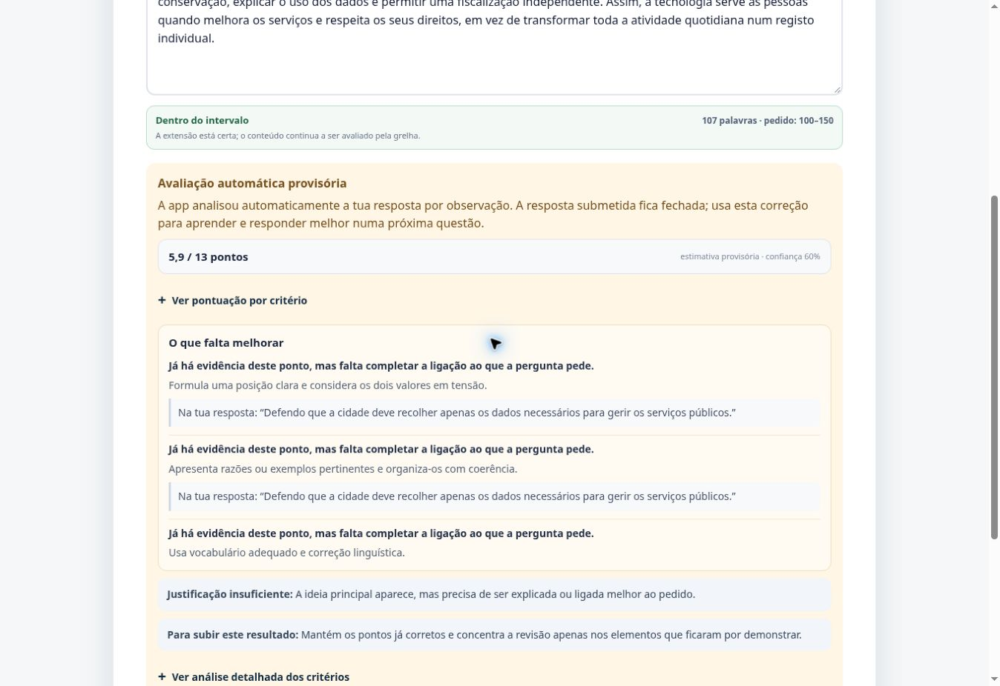
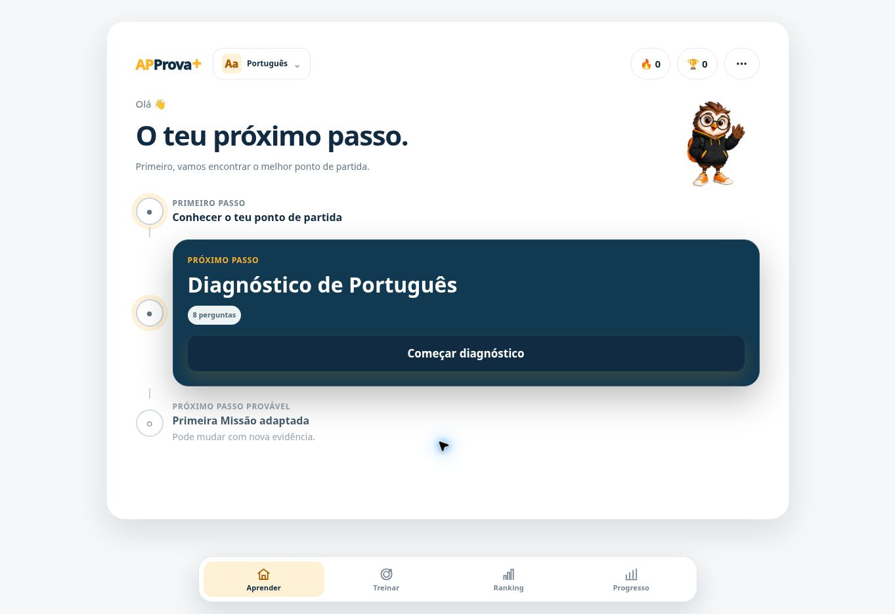
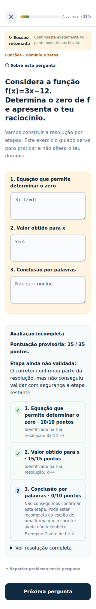
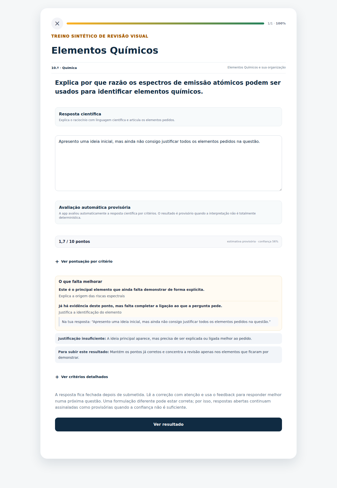

# APProva+ — revisão de experiência #417 — 26/10/2026

Estado de execução: candidata isolada; **sem publicação em produção**. Este relatório documenta a revisão posterior às publicações #412/#414/#415/#416, que já estão na base. Não reabre a cadeia antiga nem reutiliza #406/#408.

## A. Alterações consolidadas

- Base: main `0364449d75c2f55151ff22e96d4c564075c960b8`.
- PR: [#417](https://github.com/carlosdanielriosazevedo/aplus-exames/pull/417).
- Head final: `552865fa5e1fb6b4110658ec54164e38bf83545c`; árvore `d440d43a81cf30fc59384d90cbeb5d4d6d196ebd`.
- Branch `codex/journey-visual-polish`, isolada porque `codex/integration-next` contém uma experiência de performance não integrada.
- Correção: texto principal a 14 px; títulos a 15 px; pontuação sem resumo duplicado; critérios detalhados em disclosures nativos, preservando os avisos de avaliação provisória, inconsistência e penalização.
- Sessões: uma saída canónica Guardar e sair; confirmação e handlers existentes mantidos. Removidas saídas redundantes, incluindo a injeção automática de Voltar pelo Shell.
- Matemática: campos guiados a 16 px, borda/padding coerentes e mesma largura nas seis resoluções.
- Português: 11.º/12.º sem matéria atual assinalada podem concluir a configuração e usar apenas anos anteriores, como a interface já prometia. Não muda o filtro curricular.
- Sem alterações nos motores de classificação, app/api, db, conteúdo, dependências, secrets ou vercel.json. Única alteração em app/lib: o mapper de explicação conserva maxPoints dos critérios; não muda notas.

## B. Correções e evidência visual

O baseline isolado `dpl_4b1x6KfZAVwSY6GNcQMzLLbtzdv6` usa o mesmo SHA da produção. Num treino de Português, com resposta sintética de 107 palavras, o bloco de correção media 2480,47 px de altura e 4552 caracteres visíveis; parte dos critérios tinha fonte de 11 px.

No preview `8859d7bb699253c361038399da492a7af3a909f0` / `dpl_2Gh34LurcAzWbhSuAbfFWgvUTUsn`, a mesma resposta conservou **5,9/13 e confiança 60%**. O bloco passou a **776,41 px e 1283 caracteres visíveis**, com texto de feedback a 14 px. Os detalhes continuam acessíveis; Enter abre e Espaço fecha o disclosure. Estas são medições deste exemplo, não uma média de toda a aplicação.

As capturas CI a 320/1920 px revelaram larguras diferentes nos campos guiados de Matemática. Corrigiu-se a coluna grid herdada e acrescentou-se verificação geométrica, sem mudar respostas ou pontuação.

No preview `5a012739a2957fec5016230f73c6a3f757dba37d` / `dpl_GtEzpoLxGdtniuD19bGEj32F5AYU`, a configuração real de Português 12.º, com zero matérias atuais, avançou para Aprender. A captura seguinte prova essa continuação; não é produção.

A revisão de FQ A reproduziu também a perda de maxPoints no detalhe: os critérios reais tinham 5 pontos cada, mas o mapper só lia o campo legado points, originando um aviso indevido. O mapper passa a preferir maxPoints explícito (incluindo zero), mantendo fallback legado. A nota, final=false e requiresReview=true não mudaram. Três testes com motor real, legado/zero e controlo negativo preservam esta distinção. A possível atribuição semântica indevida de crédito parcial à resposta genérica está na [#419](https://github.com/carlosdanielriosazevedo/aplus-exames/issues/419) e continua por rever.

## C. Testes e resultados

[Beta CI final 40325558331](https://github.com/carlosdanielriosazevedo/aplus-exames/actions/runs/40325558331): **SUCCESS**, job `121581220797`, head `552865fa5e1fb6b4110658ec54164e38bf83545c`, merge de teste `e3f0b82d83734fa0a608cb18233b99dcd25a87bd` sobre main0364449.
- **173/173 browser PASS em 8,4 min**, incluindo os três percursos completos e os novos testes.
- **839/839 unitários PASS**, 110 ficheiros.
- **770 verificações sintéticas de recuperação PASS**.
- **Technical Gate GO**, auditorias Grader Quality, Score Explainability e restantes etapas executadas com sucesso; build integral PASS.
- Bundle **total por rota**, incluindo partilhados: home **350,7/650 KiB**, mini-exame Português **449,5/500 KiB**. Limites mantidos.
- Content Readiness executado: **human-review readiness 10%; NO-GO nesse lane**. O exit0 do relatório e o CI verde não equivalem a revisão humana concluída nem desbloqueiam produção comercial.
- [Artefacto 12650509632](https://github.com/carlosdanielriosazevedo/aplus-exames/actions/runs/40325558331/artifacts/12650509632), expira em 29/10/2026 12:59:18Z. SHA256 `59b5bc9b1d6bdee106addbff2db981f6b9edb09f43eb70a272eaa7a885d7794d`. Capturas finais PT390, FQ1366 e Math320 inspecionadas; as selecionadas ficam preservadas junto deste relatório.

Cobertura adicionada: 18 casos de correção (3 disciplinas × 320/360/390/430/1366/1920), três percursos completos e dois casos de âmbito curricular 11.º/12.º. Os percursos usam UI real, respostas sintéticas, requests externos bloqueados e ausência de pageerror exigida. Incluem diagnóstico, Missão, treino, Mini-exame, correção, Progresso, Ranking e Rever Matéria. A matriz de cabeçalhos existente cobre os quatro menus e Apronso; não é teste num telefone físico.

Validação local: syntax:audit **630 ficheiros PASS**, **839 unitários PASS**, auditoria Score Explainability **GO**, Technical Gate **GO**, build integral e budgets **PASS**, `git diff --check` PASS. Chromium local não arrancou neste runtime; usaram-se Chromium CI e browser real remoto. Não se enfraqueceram limites nem eliminaram testes.

Histórico de falhas, sem ocultação:
- 40251145482 / 8909395: 165 PASS, 6 FAIL no matcher toBeDisabled aplicado a fieldset. Corrigido para atributo disabled e cada textarea; preservado o teste de bloqueio após submissão.
- 40319371989 / e569b397: SUCCESS integral, mas SHA intermédio, não aprova alterações seguintes.
- 40319713867 / 8859d7b: primeira tentativa cancelada após download apt bloqueado; segunda falhou em quatro testes de pausa de Matemática e atingiu o timeout global (119 PASS). O botão canónico abre a confirmação existente; os testes dispensavam o diálogo por omissão. Agora verificam tipo/mensagem e aceitam explicitamente antes de exigir cartão de retoma/dados.
- 40322556069 / 5a012739 e 40323340259 / e1b639fa: cancelamentos solicitados por terem sido substituídos por correções reais, evitando continuar CI de heads ultrapassados. No primeiro, os três percursos e os dois novos testes 11.º/12.º já tinham PASS; isso não equivale a CI integral.
- 40323587240 / cf902613: **173 browser PASS em 8,3 min, 770 compatibilidades PASS**, mas **834/836 unitários**. Dois contratos antigos ainda exigiam o guard de onboarding removido. Foram atualizados mantendo guardas de seleção/nota e disponibilidade do diagnóstico de 10.º; nenhum teste eliminado. A nova UI já tinha provado ausência de perguntas atuais sem matéria.
- 40325115764 / 40f55100: CANCELED, confirmado; substituído pela correção real do mapper; não é aprovação.
- 40325558331 / 552865fa: execução final detalhada acima. A aprovação só se refere ao head final indicado e respetivo CI.

## D. Persistência, avaliação e recuperação

O contrato final passou **770 verificações em memória, sem rede**, incluindo diagnóstico concluído/incompleto, missão/treino/mini-exame, respostas/correções, progresso das três disciplinas, dados antigos, atualização e leitura pelo loader seguro anterior. O controlo negativo continua a reproduzir eliminação de rascunhos pela versão antiga insegura. Os ensaios de browser incluem encerramento/reabertura do Chromium e retoma de sessões.

Nesta revisão não se repetiram login/cloud numa conta de teste. Não há mudanças nesses módulos; não se declara novo smoke autenticado de produção. Não há migração, reset, limpeza de sessões ou mudança de schema. A saída única usa os mesmos handlers; testes de retoma/reset continuam obrigatórios. Os snapshots são sintéticos. Não se usaram contas, credenciais ou respostas de alunos.

**Bloqueio pedagógico concreto [#418](https://github.com/carlosdanielriosazevedo/aplus-exames/issues/418):** PT639-FND-126 pede uma tese livre mas aceita quatro formulações fixas. A tese de referência recebe 13/13; a mesma tese acrescida de «porque isso melhora a concentração» recebe 0/13 final. Reproduzido em browser e probe com o motor real. A PR não muda o corretor. Não resolver com substring permissivo ou exceção de frase: exige classificação editorial das tarefas livres/fechadas e casos de paráfrase, justificação, contradição e resposta vaga, preservando IDs/histórico/fingerprints. productionEligible=false e revisão humana pendente mantêm-se.

A recuperação documentada na #373 continua a excluir 98e811f/90b55fe como destinos seguros. Preferir correção progressiva sobre os módulos protegidos; qualquer promoção de recuperação exige repetir a compatibilidade com o estado da candidata. O contrato sintético não prova backup/PITR da base real nem recupera dados que tenham sido apagados sem cópia. Nenhum rollback real foi ensaiado.

## E. Vercel e controlo

Preview final, exclusivamente no projeto isolado `prj_8n5XwTMF651SAfsykIDji93oZp3r`:
- Deployment `dpl_5HBGUiU5dPhPdCTifEeaTReizsZG`.
- https://applus-beta-synthetic-isolated-o79lss719.vercel.app/
- SHA 552865fa…, target preview/null. **READY**, SHA e projeto confirmados por API; landing aberta no browser real. A prontidão técnica não equivale à validação integral. O endpoint de build logs do conector devolveu 404 mesmo com scope explícito; os valores de budget acima são os logs reais de build CI/local, não uma alegação de leitura dos logs Vercel.

Não foram criadas bases de dados, serviços pagos, domínios ou projetos novos nesta revisão. Os builds foram deliberados no ambiente existente. Sem medição de faturação/CPU, não se inventa poupança monetária.

O laboratório anterior já comprovou na #373 (comentário 6390234501): Git false impediu objetos intermédios; Ignored Build Step criou dois CANCELED; reativar Git publicou o head acumulado. Publicação manual com Git false foi ensaiada com staging/promoção do mesmo ID. Esta revisão não repetiu experiências no projeto real. Manter Git bloqueado e autoAssignCustomDomains=false, sem reativação como limpeza.

## F. Produção

Consulta final: main **0364449d75c2f55151ff22e96d4c564075c960b8**. Os aliases **approvamais.pt e www.approvamais.pt** mantêm **dpl_Yv1QzjFm9HXu2dfoZ2fJzZntYFze**, READY / production, SHA0364449, projeto real **prj_H0nD83gkRwu7Id05OhzL4CC60s4M**, confirmado por API.

Nenhum merge, deployment, promoção, rollback, alteração de configuração, credencial, API/BD ou operação de teste com escrita sobre dados de produção nesta revisão. Não se auditou cada registo real; a preservação foi ensaiada com fixtures representativas.

## G. Decisão

**NO-GO para merge/publicação desta candidata enquanto houver os achados pedagógicos #418/#419 por resolver.** As correções de apresentação e mapeamento técnico não aprovam a classificação das respostas livres. A PR permanece Draft, sem merge ou auto-merge. A revisão humana continua pendente e productionEligible=false. Um CI integral verde será uma aprovação técnica do SHA, não uma aprovação pedagógica/comercial.

## H. Próximo passo concreto

1. Resolver editorialmente #418 e a componente semântica de #419 com um conjunto de respostas sintéticas aprovadas; preservar a política e o histórico. Não declarar excelência pedagógica a partir do aspeto visual ou de CI verde.
2. Exigir CI integral no head final após qualquer correção, sem baixar budgets; rever a candidata isolada e fechar findings.
3. Só com os gates resolvidos, integrar a PR única mantendo Git false e domínios automáticos desativados; validar a árvore e o CI do SHA de merge, e inventário sem deployments automáticos.
4. A publicação manual em produção requer a confirmação prevista em AGENTS.md. Preparar um único deployment no projeto real fixado no SHA aprovado, com os domínios ainda no deployment atual; validar READY, health, navegação e continuação com perfis sintéticos sem escritas.
5. Promover esse mesmo ID uma vez, sem rebuild, só depois de GO explícito. Confirmar aliases, SHA, health e observação inicial. Manter o serviço anterior acessível durante staging; não reativar automatismos nem usar versões destrutivas como rollback.
